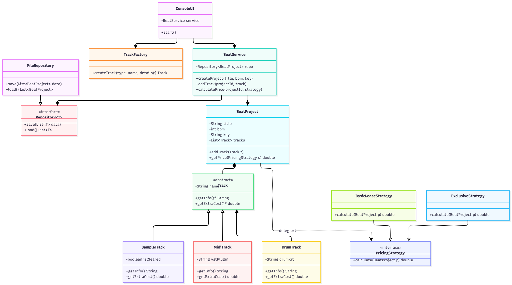

# Beat_Manager_Niveau_4

## Ziel der Applikation
Ich entwickle eine Java-Konsolenapplikation, mit der Musikproduzenten ihre Beat-Projekte übersichtlich verwalten können. Es geht dabei nicht um die Verarbeitung echter Audiodateien, sondern um die Organisation der Projektdaten (BPM, Tonart, Status), der verwendeten Spuren und die automatische Berechnung von Verkaufspreisen für verschiedene Lizenzmodelle.

## Muss Kriterien
* **Projekte verwalten:** Neue Beat-Projekte mit Name, BPM und Tonart erstellen, anzeigen und löschen.
* **Spuren hinzufügen:** Verschiedene Spur Typen einem Projekt zuweisen, wobei jeder Typ eigene Eigenschaften hat.
* **Lizenzpreise berechnen:** Automatische Preisberechnung für einen Beat je nach Lizenzmodell und den enthaltenen Spuren.
* **Eingaben prüfen:** Ungültige Eingaben oder nicht freigegebene Samples beim Exklusiv Verkauf mit eigenen Fehlermeldungen abfangen.
* **Speichern und Laden:** Alle Projekte lokal in einer Datei speichern, damit die Daten beim nächsten Programmstart wieder da sind.

## Nice-to-Have
* **Such und Filterfunktion:** Beats gezielt nach BPM-Bereichen, Tonart oder Genre durchsuchen.
* **Royalty Split Rechner:** Aufteilung der Einnahmen in Prozent berechnen, wenn mehrere Produzenten an einem Beat mitgearbeitet haben.
* **Vertrags Export:** Eine kurze Textdatei mit den Lizenz und Preisdetails als Kaufübersicht für Kunden generieren.

## UML Klassendiagramm

### KI Prompt
_Sie erstellen eine Skizze der geplanten Architektur (UML Klassendiagramm). Zu meinem Projekt: einen Beat und Musikprojekt Manager als Konsolen Applikation in Java umsetzen.   Dabei geht es nicht um echte Audiodateien, sondern um ein Verwaltungstool für Musikproduzenten: Man kann Beat-Projekte (mit BPM, Tonart etc.) erfassen, verschiedene Spur Typen wie Samples, Drums oder MIDI-Spuren hinzufügen (Vererbung/Polymorphismus) und automatisch Verkaufspreise für verschiedene Lizenzmodelle berechnen lassen (Design Patterns). Auch eigene Exceptions, eine eigene generische Klasse (z. B. für die Datenverwaltung/Suche) und Speicherung via JSON/CSV_

## Anforderungen und Use Cases

## Technische und Funktionale Anforderungen
* **3-Schichten-Trennung:** Saubere Aufteilung in Konsolen-UI (Eingabe/Ausgabe), Service-Logik (Verwaltung und Berechnungen) und Datenhaltung (Speichern/Laden via Datei).
* **Validierung und Fehlerbehandlung:** Alle Benutzereingaben werden geprüft (z. B. BPM muss zwischen 40 und 300 liegen, Name darf nicht leer sein). Bei Fehlern werden eigene Exceptions geworfen.
* **OO-Konzepte:** Einsatz von Vererbung und Polymorphismus bei den Spur-Typen, Delegation bei der Preisberechnung sowie mindestens zwei Design Patterns (Strategy für Lizenzmodelle, Factory für die Spur-Erstellung).

## Use Cases 
* **UC1: Beat-Projekt erstellen:** Der Benutzer legt ein neues Projekt mit Titel, BPM und Tonart an.
* **UC2: Spuren hinzufügen:** Der Benutzer wählt ein bestehendes Projekt aus und fügt eine Spur hinzu inklusive der spezifischen Infos.
* **UC3: Alle Projekte & Spuren anzeigen:** Der Benutzer lässt sich eine Übersicht aller gespeicherten Beats inklusive der enthaltenen Spuren und deren Details in der Konsole ausgeben.
* **UC4: Lizenzpreis berechnen:** Der Benutzer wählt ein Projekt und ein Lizenzmodell. Das Programm prüft die Spuren und berechnet automatisch den Verkaufspreis.
* **UC5: Projekt löschen:** Der Benutzer entfernt ein nicht mehr benötigtes Beat Projekt aus der Liste.
* **UC6: Daten speichern & laden:** Der Benutzer speichert seine Projekte in einer Datei (CSV/JSON), und das Programm lädt diese beim nächsten Start automatisch wieder.
